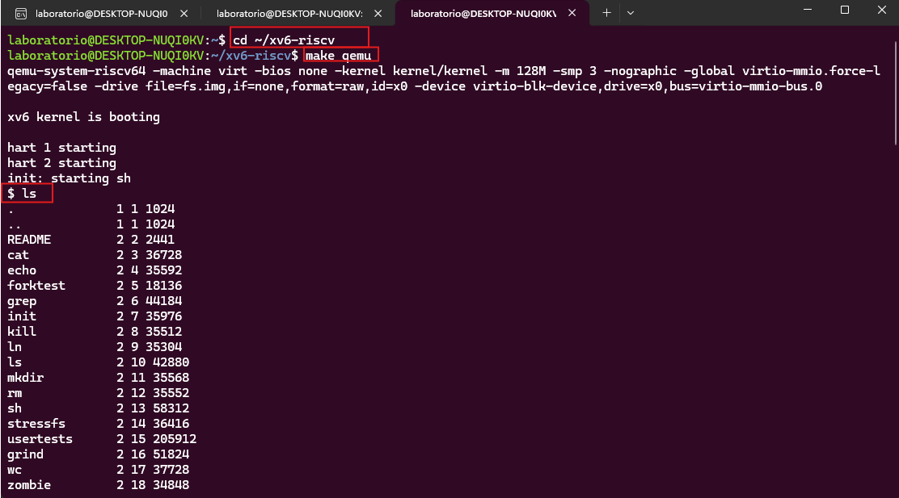
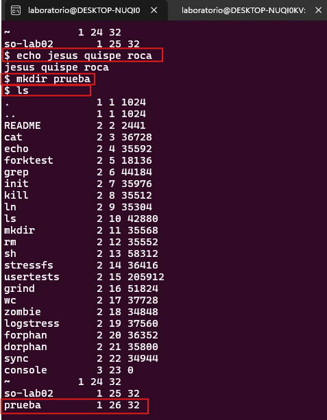
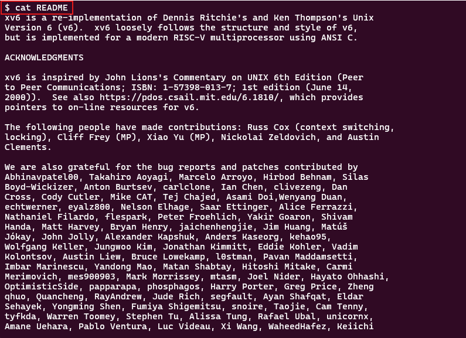
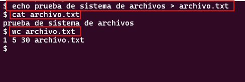
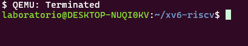
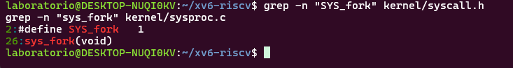
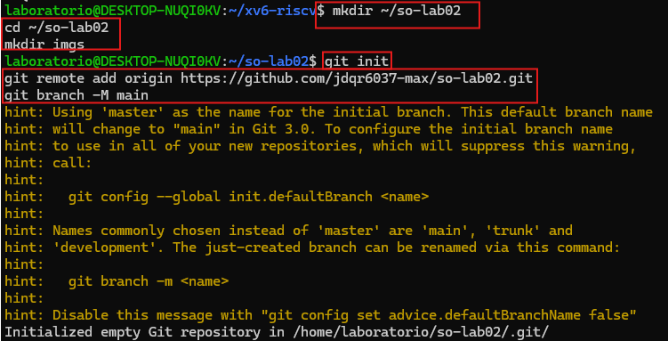

# Laboratorio 02: Sistema de Archivos xv6

## Descripción breve
En esta práctica de laboratorio, se inicializó el sistema operativo xv6 mediante el emulador QEMU. Se ejecutaron comandos básicos en el shell para interactuar con el sistema de archivos, incluyendo la creación de directorios, lectura de archivos y redirección de flujos. Posteriormente, se exploró el código fuente del núcleo utilizando la herramienta `grep` para entender cómo se estructuran las llamadas al sistema.

## Parte A y B: Comandos ejecutados en xv6
Los comandos ejecutados dentro del entorno xv6 fueron los siguientes:
- `ls`
- `echo [jesus quispe roca]`
- `mkdir [so-lab02]`
- `ls`
- `cat README`
- `echo prueba de sistema de archivos > archivo.txt`
- `cat archivo.txt`
- `wc archivo.txt`

**Capturas de la secuencia ejecutada (Parte A y B):**

## Parte C: Resultados de los grep
Al ejecutar las búsquedas con `grep` en el código fuente para las llamadas al sistema `fork` y `read`, se obtuvieron las siguientes coincidencias en los archivos del sistema:

[Pega o describe aquí brevemente el texto que te salió en la terminal al hacer los comandos grep]

**Captura de los resultados:**

## Parte D

